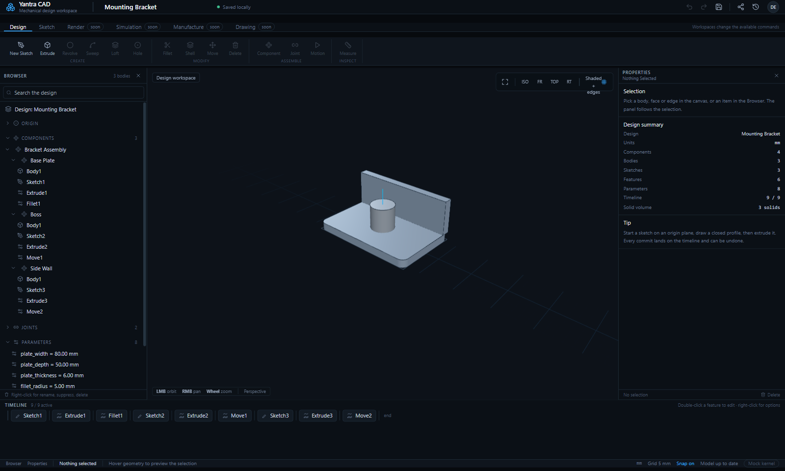

# Yantra CAD

A browser-based mechanical CAD workspace inspired by professional CAD tools (Fusion-style workflow, original UI): open a design, orbit a real 3D model, pick bodies and faces, sketch a profile, extrude it, edit the feature from the timeline, undo/redo, and save locally.

**Live app:** https://site-45f0583ab1dd4bd09aec9ad1f6315563.freebuff.page
**Architecture & verification review (plain HTML, no JS):** https://site-45f0583ab1dd4bd09aec9ad1f6315563.freebuff.page/review/



## What it does

- **3D viewport** — React Three Fiber scene with orbit (left-drag), pan (right-drag / middle), zoom, grid and origin axes, three lights, raycast selection of bodies, faces and edges, hover and selection highlight, fit-to-view (`F`), standard views (`1`–`4`), Shaded / Shaded+edges / Wireframe, right-click menu.
- **Browser tree** — live design tree: design, origin planes, components → bodies → sketches/features, joints, parameters with evaluated values. Selection, visibility toggles, rename, delete, error/warning dots, two-way highlight sync with the canvas.
- **Properties** — changes with the selection: face area/normal/centroid, edge length/endpoints, body volume/surface area/bounding box/triangle count/material, sketch (entities, dimensions, constraints, fully-constrained badge), feature (editable expressions, status, suppress/delete), component (transform, material), parameter (expression, computed value, consumers), joint, origin plane.
- **Timeline** — ordered feature history with selection, double-click edit, rollback markers, suppress/rename/delete, per-feature error badges.
- **Commands** — one reusable flow (panel → fields → validation → live preview → OK/Enter → commit → undo snapshot): New Sketch, Extrude (new body or cut-through-hole), Fillet, Shell, Move, Delete. `Esc` cancels, `Enter` confirms.
- **Sketch workspace** — plane session with line, rectangle, circle and polyline tools, snapping, dimensions, horizontal/vertical/coincident/parallel/perpendicular constraints and a DOF/fully-constrained indicator.
- **Undo/redo** — every commit is undoable (`Ctrl+Z`, `Ctrl+Shift+Z` / `Ctrl+Y`), plus autosave to `localStorage`, version snapshots and share dialog.

## Stack

React 19 + TypeScript (strict) · Vite 6 · Tailwind CSS 3.4 · Zustand 5 · React Three Fiber 9 + Three.js + Drei · Zod 3 · Lucide React · `earcut` for profile triangulation.

## Getting started

```bash
npm install
npm run dev      # http://localhost:3000
npm run build    # tsc --noEmit && vite build, then injects the crawler shell
npm run preview  # serve the production build
```

## Architecture

State is split into five Zustand stores — `designStore` (document), `selectionStore`, `commandStore`, `historyStore` and `uiStore`. UI components never mutate geometry: every edit is dispatched to `src/services/*`, which clones the document, applies the change, records an undo snapshot and swaps it in (`commit()` in `src/services/document.ts`).

Geometry is derived, never stored. `src/model/regenerate.ts` replays the active timeline and returns per-body `SolidSpec` solids plus a status per feature; `src/geometry/solid.ts` turns those into Three.js geometry (earcut triangulation with holes, shell, fillet rounding, coplanar face area, volume).

```
src/
  types.ts                 document + selection types
  geometry/solid.ts        SolidSpec → BufferGeometry, triangulation, holes, measurements
  model/                   expressions, sketch solver, profile extraction, regeneration, sample design
  stores/                  design, selection, command, history, ui
  services/                document commits, commands, validation, actions, metrics, versions
  components/              App layout, TopBar, WorkspaceTabs, Toolbar, BrowserPanel,
                           Viewport3D, PropertiesPanel, CommandPanel, Timeline, StatusBar, dialogs
sites/index.js             static asset worker (SPA fallback, real 404s for /assets/*)
scripts/inject-shell.mjs   postbuild step that injects the pre-rendered shell into dist/index.html
public/review/             plain-HTML review page and screenshots
```

## Interaction map

| Input | Action |
| --- | --- |
| Left-drag / wheel / right-drag | Orbit / zoom / pan |
| Click | Select body, face or edge |
| `Ctrl`+click / `Shift`+click | Add to / remove from selection |
| `F`, `1`–`4` | Fit to view, Isometric / Front / Top / Right |
| `Ctrl+Z`, `Ctrl+Shift+Z` / `Ctrl+Y` | Undo, redo |
| `Ctrl+S` | Save document + version |
| `Delete` | Delete selection |
| `Esc` / `Enter` | Cancel / confirm the active command |
| Right-click | Context menu |

## Deliberate limits

Mock prismatic kernel (extrusion, through holes, rounded corners, shelled prisms, moves — no NURBS or general booleans), a simplified sketch solver (rectangle/circle dimensions exact, line constraints iterative), and per-browser persistence with no backend, accounts or collaboration. Simulation, CAM, PCB, drawings and motion are "coming soon" workspaces only.

## Deployment

Static build plus a tiny Worker: `sites.manifest.json` deploys `dist/` with `sites/index.js`. The build's `postbuild` step injects the rendered shell so crawlers see real page content, and `/review/` serves a JavaScript-free architecture and verification document.
